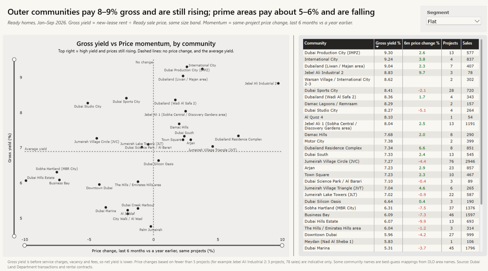
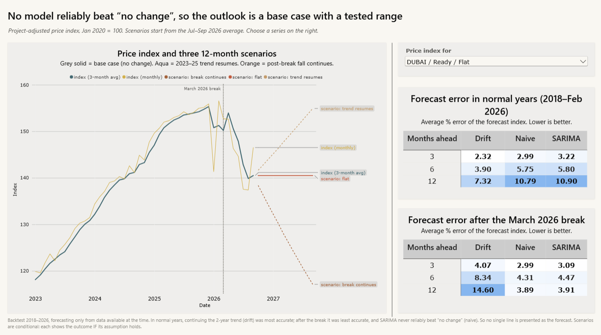
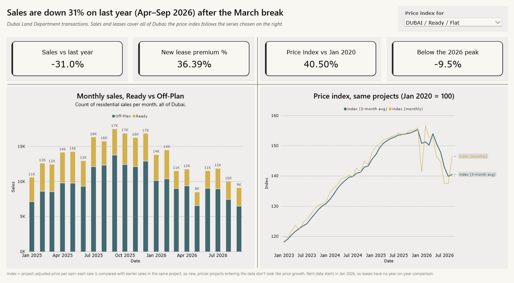

# Dubai rental yield and price forecast

**Live app (Dubai Yield Map):** <https://dubai-yield-map.streamlit.app/> · **Power BI report:** `powerbi/Dubai_Yield_Map.pbix`




## The question

1. Which Dubai communities give the best **rental yield** and **price momentum**?
2. Where are prices heading over the **next 12 months**?

Built from Dubai Land Department (DLD) sales records for 2010–2026 and 2026 rental contracts.

## The answer, as of September 2026

**Yield and momentum: cheaper outer communities pay the most rent for the price and are still rising.**

| Group | Community | Gross yield | 6-month price change (same projects) |
|---|---|---|---|
| Outer | Dubai Production City | 9.3% | +2.6% |
| Outer | International City | 9.2% | +3.8% |
| Prime | Dubai Hills Estate | 6.1% | −9.9% |
| Prime | Business Bay | 6.1% | −7.3% |
| Prime | Downtown Dubai | 6.0% | −4.2% |
| Prime | Dubai Marina | 5.3% | −3.7% |

**12-month outlook for Ready flats** (Dubai-wide):

| Scenario | 12-month change |
|---|---|
| Base case: no change | 0% |
| Downside: post-break fall continues | −16.6% |
| Upside: 2023–25 trend resumes | +10.3% |

Sales fell 31% year on year (Apr–Sep 2026) after a break in March 2026.

## Method (what makes the numbers trustworthy)

- **Source check.** The 2010–2026 sales mirror was reconciled against the official DLD 2026 file: monthly counts are within 5%.
- **Cleaning.** Rows are flagged with the first rule they fail, never deleted. Two rules that silently dropped valid data were found and fixed.
- **Like-for-like gross yield.**
  - New-lease rent per sqm ÷ Ready sale price per sqm, matched by community, Flat/Villa and size band.
  - The naive version was off by up to 1.9 points.
- **Same-project momentum.** Price change measured for the same projects, so new, pricier launches don't look like growth.
- **Price index.**
  - log(price per sqm) = project effect + month effect, with Jan 2020 = 100.
  - Tested on synthetic data: largest error 4%, against 29% for raw medians.
- **Forecast backtest.**
  - SARIMA vs "no change" vs "continue the trend", forecast from 2018 every 3 months, using only data available at the time.
  - No model was reliable both in normal years and after the 2026 break, so the outlook is a base case plus stated scenarios rather than one line.

## Repository

| Folder | Contents |
|---|---|
| `python/`, `sql/` | Pipeline: load → clean → metrics → index → backtest → scenarios → exports (run in numbered order) |
| `steps/` | Write-up of each step, with the reasoning and the mistakes caught along the way |
| `powerbi/` | Report file and theme |
| `app/` | Streamlit app "Dubai Yield Map": tile map, yield vs momentum scatter, 12-month outlook and yield calculator, for flats and villas. Unit tests and an app smoke test; CI runs in `.github/workflows/` |
| `reference/area_names.csv` | Mapping from DLD area names to the community names people use, with the evidence and a confidence flag for each |

Raw data and the DuckDB database are not committed (`data/` is in `.gitignore`).

### Run the app locally

```
pip install -r app/requirements.txt
streamlit run app/streamlit_app.py
```

## Limits

- Yields are **gross**, before service charges, vacancy and fees.
- Scenarios exist only for the Dubai-wide series and Dubai Marina flats. Other communities have under 8 years of monthly history.
- Rent data starts in Jan 2026.
- DLD areas don't always match one community. Areas that mix several (e.g. Jebel Ali 1, Wadi Al Safa 7) keep a neutral name and are flagged `check` in `reference/area_names.csv`.
